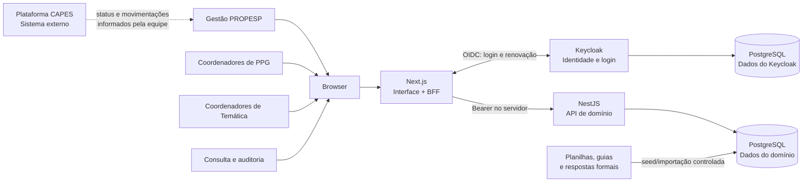
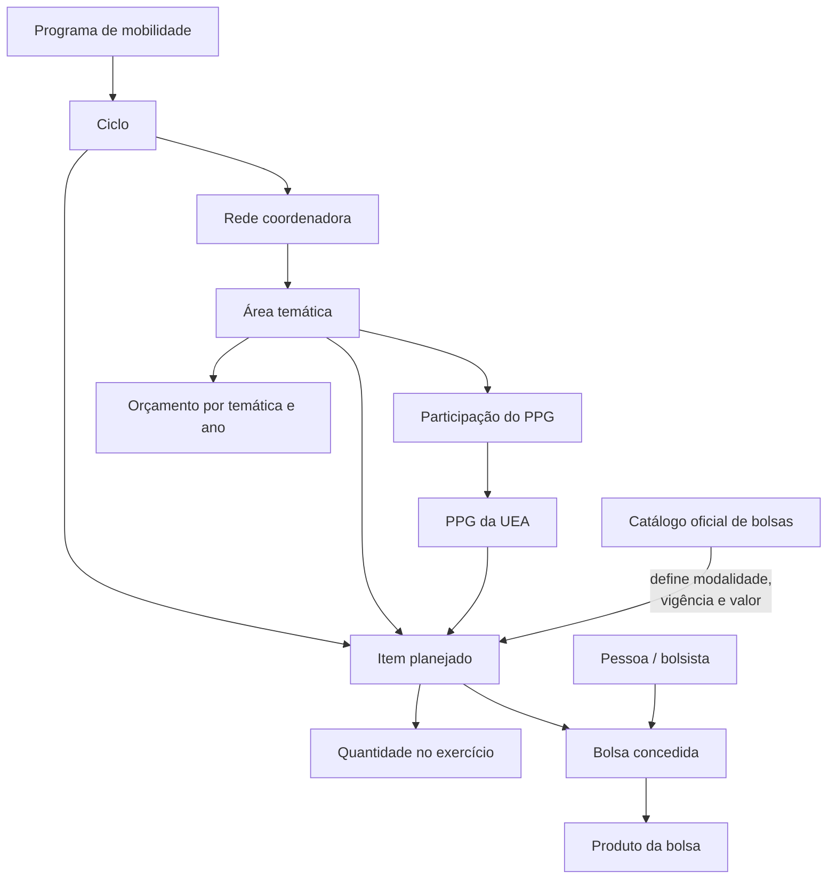
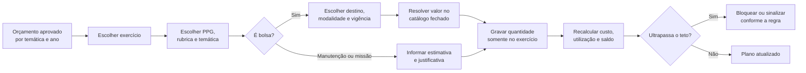
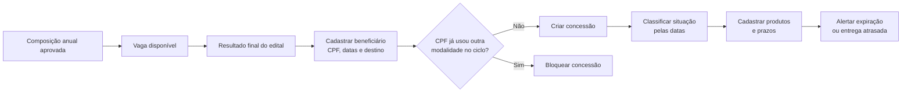
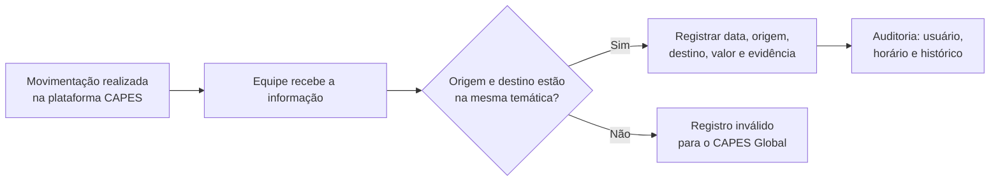
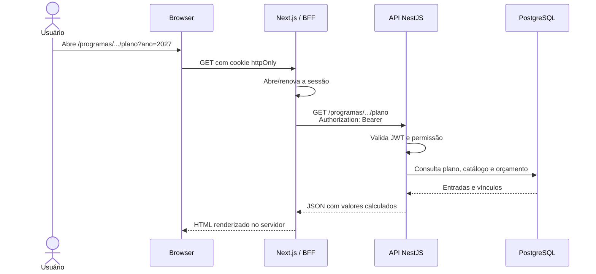
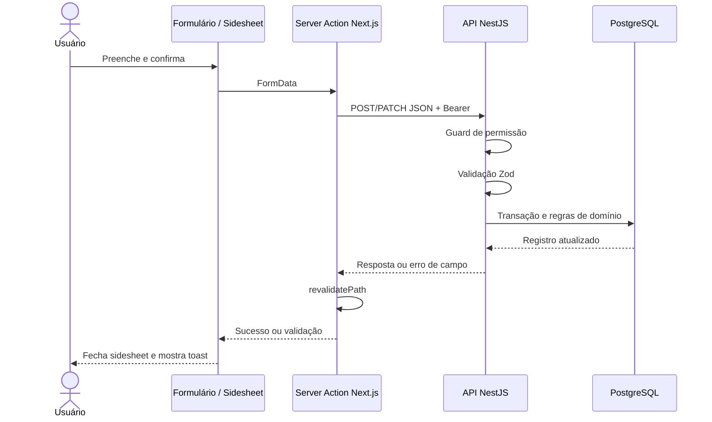
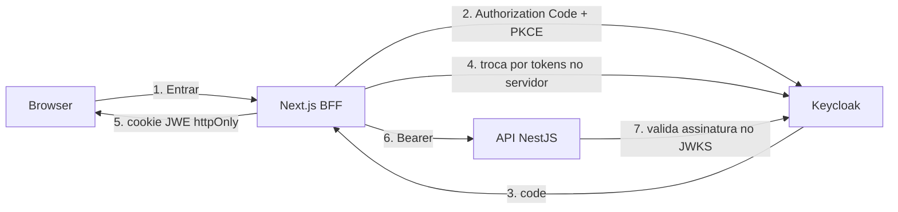

# Arquitetura do Gerenciador PROPESP

Este documento explica o sistema em duas perspectivas:

1. **Negócio:** o que o Gerenciador resolve e como as informações se relacionam.
2. **Tecnologia:** como uma ação sai da tela, passa pela API e chega ao banco.

É a leitura inicial recomendada para uma pessoa nova no projeto. A especificação
detalhada das regras e das páginas continua em
[system-structl.md](../system-structl.md), e as decisões de implementação ficam em
[AGENTS.md](../AGENTS.md).

---

## 1. O sistema em uma frase

O Gerenciador PROPESP organiza o **planejamento e acompanhamento dos recursos de
internacionalização da pós-graduação da UEA**, ligando orçamento, bolsas, PPGs,
beneficiários, destinos e produtos entregues.

O programa ativo é o **CAPES Global 2027–2030**. O modelo aceita outros programas,
mas eles permanecem inativos e fora da interface até uma futura ampliação de escopo.

### O que está dentro e fora

| O Gerenciador faz | O Gerenciador não faz |
|---|---|
| Planeja orçamento e composição anual de bolsas | Não movimenta dinheiro da CAPES |
| Calcula custo, utilização e saldo potencial | Não registra empenho ou pagamento do CAPES Global |
| Organiza redes, temáticas e PPGs | Não seleciona o beneficiário no lugar do edital |
| Registra bolsas concedidas, datas e destinos | Não executa remanejamento na plataforma CAPES |
| Acompanha produtos individuais dos bolsistas | Não substitui Sucupira, Lattes ou sistema acadêmico |
| Preserva pendências, decisões e fontes | Não cria novas modalidades para o catálogo CAPES Global |

No CAPES Global, os pagamentos e as movimentações acontecem **fora** deste
sistema. A equipe informa manualmente o resultado desses eventos; o Gerenciador
registra autoria, data e histórico.

---

## 2. Mapa de contexto



### Responsabilidade de cada peça

| Peça | Responsabilidade | Não deve fazer |
|---|---|---|
| **Browser** | Exibir HTML, interagir com formulários e manter o cookie de sessão | Receber ou armazenar access token |
| **Next.js** | Renderizar a interface, manter a sessão e agir como BFF | Reimplementar regras de negócio da API |
| **NestJS** | Validar token, autorizar, validar entradas e aplicar regras | Confiar que a interface já protegeu a ação |
| **PostgreSQL de domínio** | Guardar entradas, vínculos, histórico e dados institucionais | Guardar totais que podem ser recalculados |
| **Keycloak** | Login, senha, tokens, papéis e sessão SSO | Guardar orçamento, bolsas ou PPGs |
| **CAPES** | Executar pagamentos e movimentações do CAPES Global | Ser tratada como banco integrado enquanto não houver integração |

O desenho é um **monólito modular**, não um conjunto de microserviços. Há duas
aplicações implantáveis — `web` e `api` — e dois bancos separados por finalidade.

---

## 3. Modelo mental do domínio

A navegação principal acompanha a hierarquia do negócio:



### Tradução prática

- **Programa:** conjunto de regras e fonte de recursos, como CAPES Global.
- **Ciclo:** período do programa, como 2027–2030.
- **Rede:** instituição coordenadora externa, como UNESP, UFMG ou UNICAMP.
- **Temática:** área com orçamento próprio dentro de uma rede.
- **PPG:** programa de pós-graduação da UEA que participa da temática.
- **Item planejado:** intenção de usar determinada rubrica em um exercício.
- **Bolsa concedida:** uma vaga planejada atribuída a uma pessoa concreta.
- **Produto:** artigo, trabalho, projeto ou outra entrega de uma concessão.

### Três distinções que evitam a maioria das confusões

#### Orçamento não é composição

O orçamento é o **teto em BRL**. A composição informa **quais modalidades e
quantidades** usarão esse teto em cada exercício.

Exemplo: a UNICAMP já tem orçamento de bolsas aprovado, mas ainda não possui
composição aprovada. Portanto, seu valor entra no aporte conhecido, mas não é
exibido como saldo livre.

#### Linha planejada não é bolsa concedida

Uma linha com quantidade 2 representa duas vagas. Depois do edital, cada pessoa
recebe uma `BolsaConcedida` própria, com CPF, datas, país, instituição e produtos.

#### Saldo potencial não é dinheiro em caixa

```text
saldo potencial = orçamento de bolsas − custo da composição aprovada
```

No CAPES Global, esse saldo existe na plataforma CAPES. Não é saldo bancário da
UEA nem execução financeira institucional.

---

## 4. Fluxos principais do negócio

### 4.1 Planejar um exercício



Regras centrais:

- 2027, 2028, 2029 e 2030 são composições independentes.
- Uma quantidade nunca é copiada automaticamente para o ano seguinte.
- Bolsa usa valor oficial do catálogo; o usuário não digita o valor.
- O catálogo CAPES Global não permite criar modalidade nova.
- Linhas pendentes não consomem orçamento nem vaga.
- Código e rubrica de uma linha existente não mudam.

### 4.2 Conceder uma bolsa e cobrar produtos



A situação temporal é calculada, não digitada:

```text
Programada → Próxima → Em vigência → Prestes a expirar → Expirada
```

Estados administrativos como `CONCLUIDA`, `CANCELADA` ou `INTERROMPIDA`
prevalecem sobre a classificação do calendário.

### 4.3 Registrar uma movimentação da CAPES

Este fluxo ainda não possui tela, mas a fronteira já está decidida:



O Gerenciador não oferece “propor”, “autorizar” ou “executar” para o CAPES
Global. Ele guarda o fato externo depois que ocorreu.

---

## 5. Como uma página funciona tecnicamente

### 5.1 Leitura de uma tela



O browser não chama a API NestJS diretamente. Isso explica por que a API não
habilita CORS e por que `apiFetch` é `server-only`.

### 5.2 Escrita por formulário



### Onde cada parte fica

| Etapa | Local típico |
|---|---|
| Página e composição visual | `apps/web/src/app/(app)/.../page.tsx` |
| Formulário | `apps/web/src/componentes/formularios/` |
| Server Action | `apps/web/src/acoes/` |
| Cliente servidor da API | `apps/web/src/lib/api.ts` e `acao.ts` |
| Rota HTTP | `apps/api/src/dominio/*.controller.ts` |
| Validação e regra | `apps/api/src/dominio/*.service.ts` |
| Tabelas | `apps/api/src/database/schema/` |
| Mudança de banco | `apps/api/src/database/migrations/` |
| Dados iniciais | `apps/api/src/database/seed/` |

---

## 6. Autenticação e autorização



Princípios:

- A senha só passa pelo Keycloak.
- Tokens ficam no servidor do Next.js, selados em cookie JWE.
- Todo endpoint da API exige login por padrão.
- Controllers pedem **permissões**, não papéis.
- A API é a autoridade final; esconder botão na interface não é segurança.

Exemplo:

```text
papel Keycloak: coordenador
        ↓ permissionsForRoles
permissões: plano:read, plano:write, bolsa:read, bolsa:write, ...
        ↓ @RequirePermission('plano:write')
resposta: 200 ou 403
```

Limitação atual: os papéis ainda são globais. O sistema sabe que um Coordenador
de Temática deve ver todos os PPGs de suas temáticas, mas ainda falta vincular o
`sub` do Keycloak à `Pessoa` local para aplicar esse escopo em cada consulta.

Detalhes de segurança: [autenticacao.md](autenticacao.md).

---

## 7. Estratégia de dados e cálculos

### Entradas são persistidas; derivados são calculados

O banco guarda orçamento, quantidade, modalidade, vigência e vínculos. Custo,
saldo, utilização e totais são calculados nas consultas SQL.

```text
Entrada persistida: quantidade = 2, valor do catálogo = R$ 82.902,20
Derivado: custo = 2 × 82.902,20 = R$ 165.804,40
```

Não crie uma coluna `custo_total` apenas para acelerar uma tela sem medir e
justificar: ela pode divergir na primeira edição.

### Dinheiro nunca usa ponto flutuante

- PostgreSQL: `numeric(14,2)`.
- Driver: devolve dinheiro como `string`.
- Web: soma em centavos com `BigInt`.
- Nunca converta valores monetários para `number` antes de uma conta.

### Nulo não é zero

`null` significa **A definir**. `0` afirma que o valor foi definido e é zero.
Essa diferença é importante para manutenção de UFMG/UNICAMP e para composições
ainda não aprovadas.

### Fontes e seed

Os dados iniciais vêm das planilhas, guias e respostas formais em `dados/` e
`respostas/`. A camada de correções confirmadas fica explícita em
`database/seed/dados-capes-global.ts`; ela não altera silenciosamente o arquivo
extraído original.

---

## 8. Mapa do repositório

```text
gerenciador/
├── apps/
│   ├── web/                  Next.js: interface, sessão e BFF
│   │   └── src/
│   │       ├── app/          páginas e rotas de autenticação/BFF
│   │       ├── acoes/        Server Actions
│   │       ├── componentes/  UI, formulários, layout e sidesheets
│   │       └── lib/          sessão, API, tipos, formato e navegação
│   └── api/                  NestJS: autenticação e regras de domínio
│       ├── src/
│       │   ├── auth/         JWT, guards, permissões e /me
│       │   ├── dominio/      orçamento, plano, bolsistas e governança
│       │   └── database/     schema, migrations e seed
│       └── test/             testes de integração com PostgreSQL
├── infra/                    Docker Compose, Keycloak e bancos
├── packages/                 configurações compartilhadas
├── scripts/                  smoke tests de login e telas
├── docs/                     arquitetura e decisões técnicas
├── system-structl.md         especificação funcional completa
└── AGENTS.md                 convenções e estado atual do projeto
```

### Exemplos para seguir uma funcionalidade ponta a ponta

| Funcionalidade | Página | Ação | Controller/Service | Tabelas centrais |
|---|---|---|---|---|
| Plano de aplicação | `.../plano/page.tsx` | `acoes/plano.ts` | `ProgramasController` / `PlanoService` | `item_planejado`, `planejamento_anual` |
| Orçamento e saldo | `.../orcamento/page.tsx` | leitura | `ProgramasController` / `OrcamentoService` | `orcamento_tematica` + plano |
| Bolsistas | `mobilidade/bolsistas/` | `acoes/bolsistas.ts` | `BolsistasController` / `BolsistasService` | `pessoa`, `bolsa_concedida` |
| Produtos | detalhe do bolsista | `acoes/bolsistas.ts` | `BolsistasController` / `BolsistasService` | `produto_bolsa` |
| Pendências | `pendencias/page.tsx` | ações de pendência | `PendenciasController` / `PendenciasService` | `pendencia` |

---

## 9. Estado atual do produto

### Implementado

- Login/logout OIDC, sessão segura e permissões.
- Programas, ciclos, redes, temáticas, PPGs e coordenadores.
- Catálogo fechado de bolsas.
- Orçamento anual, composição anual, custo, saldo e divergência.
- Plano de aplicação por exercício, rede, temática e PPG.
- Cadastro individual de bolsista com CPF, destino e datas completas.
- Alertas temporais e produtos individuais por bolsa.
- Pendências e Comitê Gestor na interface; premissas e fontes preservadas
  internamente para rastreabilidade e futuro uso em Documentos e evidências.
- Seed real, migrations, testes unitários, integração e smoke tests.

### Próximos blocos

- Escopo real de autorização por PPG/temática.
- Upload/versionamento de documentos pessoais e evidências.
- Registro de eventos e movimentações externas da CAPES.
- Panorama e mapa de mobilidade.
- Relatórios e exportações.
- Importação por adaptador de programa.
- Produção consolidada e convênios.

O checklist funcional atualizado está no
[§11 de system-structl.md](../system-structl.md#11-checklist-de-decisões-e-pendências).

---

## 10. Roteiro para um novo desenvolvedor

### Primeiros 30 minutos

1. Leia este documento até o fim.
2. Abra [system-structl.md](../system-structl.md) §§2, 3 e 5 para conhecer os
   termos e regras.
3. Leia [AGENTS.md](../AGENTS.md) §§2, 3, 7, 8 e 9 para conhecer as convenções.
4. Rode o projeto e navegue nesta ordem:
   `Painel → Programas → Plano de aplicação → Bolsistas → Pendências`.
5. Siga uma linha de plano da página até `PlanoService` e o schema.

### Subir o ambiente

```bash
nvm use
pnpm install

cp infra/.env.example infra/.env
pnpm infra:up

cp apps/api/.env.example apps/api/.env
cp apps/web/.env.example apps/web/.env.local

pnpm --filter api db:migrate
pnpm --filter api db:seed --reset  # destrutivo: apenas para ambiente descartável
pnpm dev
```

Acesse <http://localhost:3000>. Usuário de desenvolvimento:
`coord.teste` / `coord123`.

### Verificar antes de entregar

```bash
pnpm lint
pnpm build
pnpm test
pnpm --filter api test:int
pnpm smoke:login
pnpm smoke:telas
```

---

## 11. Como fazer uma mudança sem quebrar o desenho

### Nova tela de leitura

1. Defina o contrato de resposta no serviço da API.
2. Proteja o controller com `@RequirePermission`.
3. Consulte pela página usando `apiFetch` no servidor.
4. Espelhe o tipo HTTP em `apps/web/src/lib/dominio.ts`.
5. Cubra o cálculo em teste de integração.

### Novo cadastro

1. Modele/ajuste o schema Drizzle.
2. Gere e revise uma migration.
3. Crie schema Zod e regra transacional na API.
4. Adicione controller e permissão.
5. Crie Server Action, formulário e sidesheet na web.
6. Revalide as páginas afetadas e mostre erro junto ao campo.

### Nova regra de cálculo

1. Escreva a regra em `system-structl.md`.
2. Identifique entradas e derivados.
3. Implemente o derivado em SQL/serviço, sem persistir total.
4. Acrescente caso real ao teste de integração.
5. Confirme que `null` e dinheiro exato continuam corretos.

---

## 12. Problemas comuns

| Sintoma | Causa provável | Ação |
|---|---|---|
| Login termina e a página inicial responde 500 com PostgreSQL `42703` | Código novo com migration ainda não aplicada | `pnpm --filter api db:migrate` |
| Tela abre, mas mostra dados antigos | Migration aplicada, seed de desenvolvimento desatualizada | Em ambiente descartável, `db:seed --reset`; nunca faça isso sem avaliar perda de dados |
| API devolve 401 | Bearer ausente, sessão vencida ou configuração OIDC incorreta | Rode `pnpm smoke:login` |
| API devolve 403 | Usuário autenticado, mas sem a permissão exigida | Confira `permissions.ts` e `@RequirePermission` |
| Build falha ao buscar Geist | `next/font` sem acesso às fontes do Google | Verifique rede ou adote fonte local numa mudança própria |
| Um valor indefinido aparece como R$ 0,00 | Conversão indevida de `null` | Use `Moeda`/`somarMoeda` e preserve o nulo |
| Formulário salva, mas a tela não atualiza | Caminho não revalidado na Server Action | Confira a lista passada a `revalidatePath` |
| API funciona no teste, mas a tela falha | Contrato HTTP ou renderização divergente | Rode `smoke:telas` e confira `lib/dominio.ts` |

---

## 13. Regras arquiteturais que não devem ser quebradas

1. O browser nunca recebe token OAuth.
2. A API é fechada por padrão e decide a autorização final.
3. O browser não chama a API NestJS diretamente.
4. Dinheiro não usa ponto flutuante.
5. `null` não é transformado em zero.
6. Totais derivados não são persistidos.
7. Composição pertence a um exercício específico.
8. O CAPES Global não tem execução financeira dentro da UEA.
9. Movimentação CAPES é fato externo, não ação executada pelo Gerenciador.
10. Toda mudança relevante preserva fonte, autoria e histórico.
