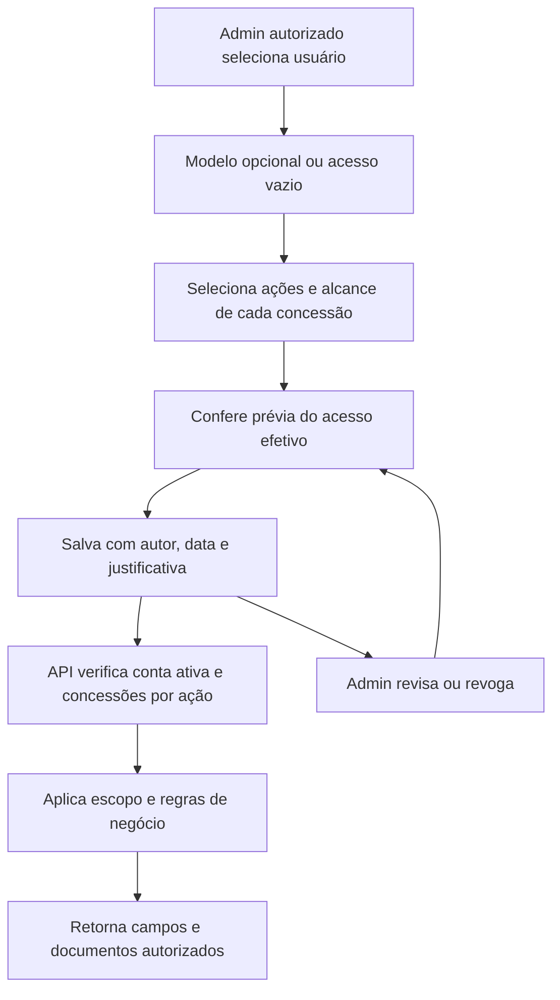

# Autorização da V1 interna — modelo aprovado pelo responsável

Data: 2026-09-15; decisões complementares em 2026-09-18. Estado: **modelo de autorização aprovado pelo responsável pelo
projeto nesta conversa**, após a proposta de concessões individuais de permissão
+ escopo e sua confirmação de acordo com o novo modelo. Isso não equivale
a homologação institucional nem altera permissões em execução. Implementação em
[backlog-v1.md](backlog-v1.md): V1-010–019 concluídas; V1-020 pendente e
V1-021 em andamento. A autorização central por
concessões já está ativa desde V1-012. Detalhamento e inventário em
[contrato-autorizacao-v1.md](contrato-autorizacao-v1.md).

## Público e responsabilidade

- Uso interno na instituição, com login e autorização na API.
- Bolsistas/discentes, parceiros externos e participantes em autosserviço não
  acessam nesta fase; seus registros continuam no domínio. Um servidor também
  discente pode receber acesso nominal para seu trabalho interno.
- Administradores e responsáveis por PPG/temática são o público principal.
- O administrador decide e responde pela atribuição dos acessos, com histórico
  de autor, data e justificativa. Isso não transfere responsabilidade jurídica
  exclusiva nem dispensa o sistema de aplicar corretamente as restrições.

## Decisão adotada: concessão individual de permissão + escopo

A aplicação será a fonte de autorização de negócio. O Keycloak continua
responsável pela autenticação; seus papéis não serão o teto das permissões de
negócio nem concederão acesso automaticamente após a transição.

Cada concessão associa **usuário + permissão + escopo**. O administrador escolhe
as ações e os registros alcançados, podendo alterar ou revogar a qualquer momento.
Perfis tornam-se **modelos opcionais de preenchimento**, sem limitar a configuração.
Aplicar um modelo gera concessões explícitas revisáveis; editar o modelo depois
não altera automaticamente os usuários que já o utilizaram.

Regras aprovadas:

1. Sem concessão válida, sem acesso. Conta inativa é recusada antes de qualquer
   atalho administrativo; conta pendente recebe orientação e opção de saída.
2. Concessões são cumulativas; não há regras de negação nesta primeira versão.
3. O alcance é calculado por ação: unir apenas concessões daquela permissão.
   Dentro de uma participação ou PPG+ciclo, todos os critérios devem coincidir.
4. Permissões de consulta, criação, edição, cancelamento, aprovação, exportação
   e dados pessoais são separadas quando representam responsabilidades distintas.
5. A API aplica o recorte no SQL antes de somas, contagens e paginação; interface,
   arquivos, buscas e downloads respeitam a mesma autorização.
6. Revogação local vale na requisição seguinte, sem depender de renovação de JWT
   e sem cache global de usuário. Outra concessão válida pode manter acesso;
   sua origem deve aparecer na prévia e na explicação do acesso efetivo.
7. Administrar acessos é privilégio protegido próprio. Ninguém pode aumentar o
   próprio acesso sem autorização específica. Definir bootstrap, recuperação e
   limites desse privilégio em V1-010/017; nunca concedê-lo por autoedição comum.
8. Permissão não dispensa regra de negócio: estado do registro, documentação,
   integridade, auditoria e transições continuam obrigatórios.

O catálogo de ações e os tipos de escopo continuam definidos pelo sistema.
Flexibilidade não significa permitir SQL, condições arbitrárias ou nomes de
permissão sem implementação. A matriz deve informar quais escopos são válidos
para cada ação, inclusive operações que são necessariamente institucionais.

## Alcances

| Escopo | Registros alcançados |
|---|---|
| `GLOBAL` | Todos os registros, somente para a permissão concedida |
| Ciclo | Registros do ciclo, para ações compatíveis |
| `PPG` + `cicloId` | Dados do PPG naquele ciclo |
| `PARTICIPACAO` | Interseção exata PPG–temática pelo ID de `participacao_ppg` |
| `TEMATICA` | Registros de todos os PPGs daquela temática |
| `REDE` | Registros da rede no ciclo |

Rede e temática pertencem a um ciclo; participação o herda pela temática.
PPG é cadastro global e exige ciclo explícito para concessões do planejamento.
Na decisão de 2026-09-16, a produção começa sem contas e não há conversão de
concessões legadas. Nenhum alvo recebe GLOBAL ou novos ciclos automaticamente.

Exemplo: Ana recebe consulta de planejamento na rede B, criação de linhas no
PPG A/ciclo 2027–2030 e escrita de bolsas na participação A/T1. Consultar B não
permite criar linhas em B; escrever em A/T1 não permite escrever em A/T2 ou B/T1.
Uma concessão GLOBAL de consulta não amplia nenhuma concessão de escrita.

## Modelos opcionais e políticas iniciais

Modelos sugeridos: Administrador PROPESP, Apoio administrativo, Responsável de
PPG, Responsável temático, Gestor da Rede, Comitê Gestor e Consulta interna.
Não é necessário criar um papel Keycloak por modelo, PPG ou temática.

Para os modelos iniciais, preservar as escolhas anteriores: edição de linhas,
orçamento e validação de prestação no modelo administrativo; secretaria instrui
bolsas/produtos/documentos; responsável cria linhas e gere bolsas no seu alcance;
gestor opera missões; comitê decide sobre missões. **Esses são padrões dos modelos,
não proibições por cargo**: uma atribuição individual explícita pode conceder
outra ação, sem contornar suas regras de negócio.

Sugestões por `participacao_ppg.coordenador_tematica_id` exigem confirmação do
admin. Alterar o responsável no cadastro não transfere acesso silenciosamente.
O vínculo ativo de equipe das missões não produz acesso implícito. A conversão
legada foi cancelada em 2026-09-16 porque a produção começa sem contas; mudança
de equipe sugere revisão e não concede acesso sozinha. A aplicação explica e
administra todas as concessões efetivas.

## Orçamento e dados pessoais

O teto é da temática/exercício, não de cada PPG. A projeção entregue na V1-013
é: recorte parcial vê seus custos e quantidades; teto/saldo só são
expostos quando há cobertura autorizada da temática inteira. Uma eventual
permissão específica de consolidado compartilhado precisa ter projeção e alcance
próprios, sem revelar linhas ocultas. Não calcular saldo fictício do PPG nem
vazar valores por gráficos, totais, alertas ou denominadores. Indisponível é
`null`, não zero.

**Política aprovada pelo responsável em 2026-09-18 e implementada na V1-015:**
CPF, e-mail pessoal e telefone exigem capacidades específicas e alcance sobre o
alvo. Sem capacidade, os valores não são enviados ao navegador, nem CPF
parcialmente mascarado. Nome e dados acadêmicos continuam disponíveis a quem
pode consultar a bolsa. Modelos de administrador e secretaria incluem as
capacidades por padrão; atribuições individuais são personalizáveis.

Quem pode cadastrar bolsa pode informar CPF mesmo sem poder consultá-lo completo.
Na edição, CPF não reenviado é preservado. Alterar CPF existente exige capacidade
específica de dados pessoais e edição no alcance do alvo. Nunca salvar máscara
como CPF nem revelar cadastro fora do alcance na verificação de duplicidade.
A V1-015 entregou isso em 2026-09-18: a projeção acontece no SQL, cruzando a
capacidade com o alcance sobre aquela bolsa, e `pessoa:edit-cpf` passou a existir
para a correção. As exportações de mobilidade reaplicam a projeção, e a
V1-016 estendeu o mesmo critério ao histórico do parceiro, aos anexos e à ficha
em PDF.

Documentos `PESSOAL` e `RESTRITA` também exigem capacidades específicas e alcance
sobre o alvo; as duas visibilidades não são equivalentes. Os modelos iniciais
reservam documentos pessoais a administrador e secretaria, com personalização
por concessão individual.

Parceiros permanecem catálogo institucional compartilhado para quem tem a
permissão; seus históricos, contagens, produtos e PDFs aplicam o recorte das
bolsas/missões. Autor de upload não supera o alcance do alvo. Dados sem temática
identificável não entram por aproximação em participação/temática; PPG+ciclo pode
alcançá-los quando ambos forem conhecidos. Correção exige concessão apropriada.

## Fluxo administrativo e consulta

Criar identidade no Keycloak e atribuir autorização local são operações distintas.
A tela de acesso não promete criar credenciais se essa integração não estiver
implementada; a V1 pode manter o provisionamento de identidade no console.

## Transição e decisões ainda necessárias

1. V1-001 registra o contrato: todas as P1 foram incluídas em 2026-09-18, junto
   com preparação para Docker, validação por permissão e backup diário de
   madrugada. Responsáveis nominais e detalhes operacionais continuam pendentes
   nas fichas correspondentes; a decisão não encerra o contrato inteiro.
2. V1-010 detalha ações, escopos compatíveis, modelos iniciais e proteção da
   administração de acesso. V1-011/012 implementam concessões e resolução central.
3. Produção começa sem contas, por decisão de 2026-09-16. Bootstrap cria o
   primeiro administrador local; não há conversão legada. Papel do token sozinho
   não concede domínio.
4. V1-013 a V1-020 cobrem leituras/escritas, campos, arquivos, administração,
   orientação e testes com personalizações fora dos modelos.
5. V1-021 confere contas nominais, recuperação e smoke da política já restritiva.
   Não implantar ou alterar contas reais pelo simples registro desta decisão.

A proposta anterior de concessão por **perfil + escopo**, condicionada a papel
ativo no Keycloak, foi substituída pela decisão desta conversa. As antigas A01–A07
passam a ter este tratamento:

| ID | Situação após a decisão |
|---|---|
| A01 | Participação é padrão sugerido do modelo temático; admin pode escolher outro alcance compatível |
| A02 | Perfis são modelos opcionais; novo papel `responsavel-tematica` não é requisito |
| A03 | Adotada concessão individual permissão + escopo; PPG do planejamento exige ciclo |
| A04 | Edição/orçamento são permissões concedíveis; padrão administrativo, com regras de negócio preservadas |
| A05 | Projeção entregue na V1-013: custo próprio no alcance parcial; teto/saldo só com cobertura integral da temática |
| A06 | Política aprovada em 2026-09-18 e implementada na V1-015 no mesmo dia: valores pessoais não enviados sem capacidade; CPF preservado na edição e alteração protegida por `pessoa:edit-cpf` |
| A07 | Secretaria global é sugestão de modelo; cada permissão pode ter alcance personalizado |

As definições operacionais restantes pertencem às tarefas; não significam
necessidade de pedir novamente aprovação do modelo já escolhido.
